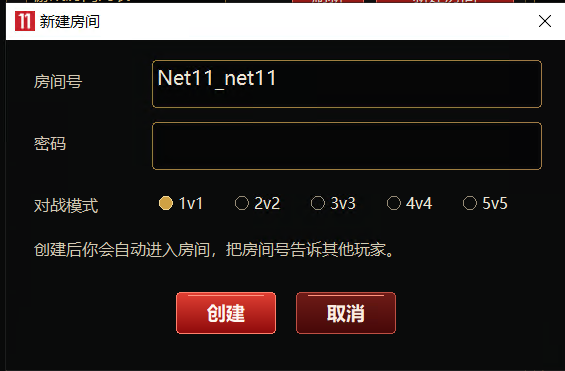

<p align="center">
  
</p>

# Net Goal 11

**LAN-play tunnel for FIFA 11 · FIFA 11 局域网对战联机工具**

[English](#english) · [简体中文](#简体中文)

- Repository / 仓库：<https://github.com/loudiwang/net-goal-11>
- License / 许可证：[GNU GPL v3.0](LICENSE)
- Clone / 克隆：

  ```bash
  git clone https://github.com/loudiwang/net-goal-11.git
  ```

---

## English

Net Goal 11 is a LAN-play tunneling tool for **FIFA 11** (native C++, release 1.02).

FIFA 11 keeps its multiplayer mode inside the local network, so players in different cities
cannot see each other's rooms. Net Goal 11 injects a small x86 Hook into the game and relays the
game's UDP traffic straight to a public relay server, which forwards it to the other players.
Everyone ends up in the game's ordinary LAN mode, as if all the machines were plugged into the
same switch — no public IP, no router port forwarding and no virtual network adapter driver.

### Features

- **FIFA 11 LAN play over the internet** — the game keeps using its standard LAN mode; the
  tunneling is completely transparent to it.
- **Direct Hook-to-relay path** — `game → Hook → public relay → peers`, with no extra local IPC
  hop and no per-packet polling, which keeps latency low.
- **Virtual LAN spoofing** — the Hook fakes a `10.213.77.0/24` subnet, so the game still sees
  ordinary LAN broadcast and unicast traffic.
- **Room system** — room list and join-by-room-code, optional room passwords, and `1v1` `2v2`
  `3v3` `4v4` `5v5` modes.
- **Simple sign-in** — start the client, enter the relay IP, the UDP port, a nickname and the
  shared passphrase `goal11`, pick the game executable, then create or join a room.
- **Relay server for two platforms** — Linux (`epoll`, single static musl binary) and Windows
  (`select`, for local testing).
- **Live status** — up/down traffic counters and a run log in the main window.

### Screenshots

| Login window | Main window |
| --- | --- |
|  |  |

<p align="center">
  
</p>

- **Login window** — relay server IP, port (default `45888`), in-game nickname and the shared
  passphrase `goal11`.
- **Main window** — game platform list on the left, room list in the middle (room code, host,
  mode, player count), nickname / game executable / single-player launch on the right, plus live
  traffic counters and the run log at the bottom.
- **Create room dialog** — room code, optional room password and the `1v1` `2v2` `3v3` `4v4`
  `5v5` mode selector; after creating the room you are taken into it and can share the room code
  with the other players.

### Repository layout

```text
Net Goal 11/
  README.md              this file
  docs/images/           screenshots and artwork used by this README
  native/
    common/              protocol, version, game-name tables
    hook/                x86 Hook injected into the game (direct relay)
    client/              Win32 client and login window
    server/              Linux / Windows UDP relay server
    build/               one-shot build with Zig
    tests/               manual / semi-automatic network and UI tests
```

### Quick start

```powershell
# 1. build (needs Zig 0.17+); output goes to native/dist/
powershell -ExecutionPolicy Bypass -File .\native\build\build_all.ps1

# 2. run the relay server locally for testing
.\native\dist\server-win-x64\"Net Goal 11.Server.exe" --port 45888
```

On a Linux VPS, unpack `Net Goal 11-server-linux-x64.zip` and run `sudo bash deploy-linux.sh`.
Remember to open the chosen **UDP port** (default `45888`) in the firewall and cloud security group.

Then start `Net Goal 11.exe`, enter the relay IP, port `45888`, your nickname and the passphrase
`goal11`, pick your game executable, create or join a room and start the match.

### Compatibility

- client and Hook must be x86 — the FIFA 11 executable is 32-bit;
- build client, Hook and server from the same revision;
- the protocol is not encrypted (room passwords are only hashed), so do not send sensitive data
  over untrusted networks.

---

## 简体中文

Net Goal 11 是一个 **FIFA 11 局域网对战** 联机工具（原生 C++ 版，Release 1.02）。

FIFA 11 的对战模式只在局域网（LAN）里可见，异地玩家原本无法互相加入房间。本工具把游戏
发出的 UDP 数据通过注入游戏的 Hook 直接中继到一台公网服务器，再由服务器转发给对手，
让不同城市的玩家像接在同一台交换机上一样进入游戏的 LAN 对战模式——不需要公网 IP，
不需要路由器端口映射，也不需要安装虚拟网卡驱动。

### 功能特性

- **FIFA 11 局域网对战联机**：游戏里照常进入 LAN 模式，联机过程对游戏完全透明。
- **Hook 直连中继**：数据面路径为 `游戏主程序 → Hook → 公网中继 → 对手`，不再多绕一次
  本地 IPC 和非停轮询，延迟更低。
- **虚拟局域网伪装**：Hook 为游戏伪造 `10.213.77.0/24` 虚拟网段，游戏看到的仍是标准
  局域网广播与单播。
- **房间系统**：房间列表 / 房间号直连、可选房间密码、`1v1` `2v2` `3v3` `4v4` `5v5`
  五种对战模式。
- **登录简单**：打开客户端，填中继服务器 IP、UDP 端口、昵称和固定口令 `goal11`，选好游戏
  主程序，即可创建或加入房间。
- **双平台服务端**：Linux（`epoll`，静态 musl 单文件）与 Windows（`select`，本机测试用）。
- **运行状态可见**：主窗口实时显示上下行流量与运行日志。

### 界面截图

| 登录窗口 | 主界面 |
| --- | --- |
|  |  |

<p align="center">
  
</p>

- **登录窗口**：填写中继服务器 IP、端口（默认 `45888`）、游戏内昵称和固定口令 `goal11`。
- **主界面**：左侧对战游戏平台，中间房间列表（房间号 / 房主 / 模式 / 人数），右侧设置
  昵称、游戏主程序路径、启动单机游戏，底部实时显示上下行流量与运行日志。
- **新建房间**：填写房间号、可选房间密码，选择 `1v1` `2v2` `3v3` `4v4` `5v5` 对战模式；
  创建后自动进入房间，把房间号告诉其他玩家即可加入。

### 目录结构

```text
Net Goal 11/
  README.md              本文件
  docs/images/           README 用截图与海报
  native/                全部源码与构建脚本
    common/              协议、版本、游戏名称表
    hook/                注入游戏的 x86 Hook（直连中继）
    client/              Win32 客户端与登录窗口
    server/              Linux / Windows UDP 中继服务端
    build/               用 Zig 一键构建
    tests/               联机与界面测试脚本
```

详细的构建、部署、使用与协议说明见 [`native/README.md`](native/README.md)。

### 快速开始

#### 1. 构建

需要 Zig 0.17 或更新版本：

```powershell
powershell -ExecutionPolicy Bypass -File .\native\build\build_all.ps1
```

产物在 `native/dist/`：

- `client-win-x86/Net Goal 11.exe` 与 `Net Goal 11.Hook.dll`
- `server-linux-x64/Net Goal 11.Server`
- `server-win-x64/Net Goal 11.Server.exe`（本机测试）
- 对应的 zip 分发包

#### 2. 启动服务器

Linux（默认 UDP 45888）：

```bash
sudo bash deploy-linux.sh
```

Windows 本机测试：

```powershell
.\native\dist\server-win-x64\"Net Goal 11.Server.exe" --port 45888
```

记得在云安全组和系统防火墙放行对应的 **UDP 端口**。

#### 3. 客户端登录

运行 `Net Goal 11.exe`，在登录窗口填写：

- 服务器 IP：中继服务器地址（本机测试填 `127.0.0.1`）
- 端口：默认 `45888`
- 昵称：默认 `net11`，可随意修改
- 密码：固定口令 `goal11`

然后设置游戏主程序路径，创建或加入房间即可开始比赛。

### 版本与兼容性

- 客户端与 Hook 必须是 x86（游戏主程序是 32 位）；
- 客户端、Hook、服务端请使用同一版本构建，不要混用旧版；
- 协议没有加密，只有房间密码哈希，请勿在不可信网络中传递敏感信息。

### 测试

`native/tests/` 内含手动/半自动测试脚本，例如：

- `direct_peer.ps1` / `direct_target.cpp`：直连与中继验证
- `lobby_test.cpp` / `lobby_list_test.cpp` / `lobby_peer.cpp`：大厅协议测试
- `ui_test.ps1` / `ui_step.ps1`：Windows 界面自动化脚本

---

## License / 许可证

本项目采用 [GNU General Public License v3.0](LICENSE) 开源发布。
This project is released under the [GNU General Public License v3.0](LICENSE).

Copyright (C) 2026 Net Goal 11 Contributors

你可以自由使用、修改和分发本项目；但若分发修改后的版本（包括仅分发二进制），必须同样以
GPL-3.0 授权，并向接收者提供对应的完整源代码。本程序不提供任何担保。
You may use, modify and redistribute this project freely; if you distribute a modified
version (including binaries only), it must also be licensed under the GPL-3.0 and you must
make the complete corresponding source code available to the recipients. There is no warranty.
