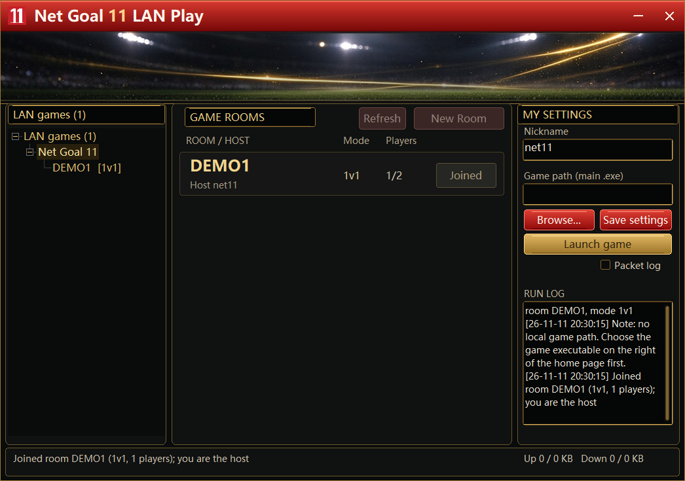
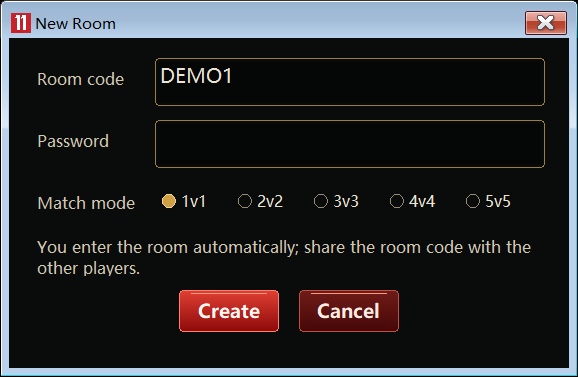
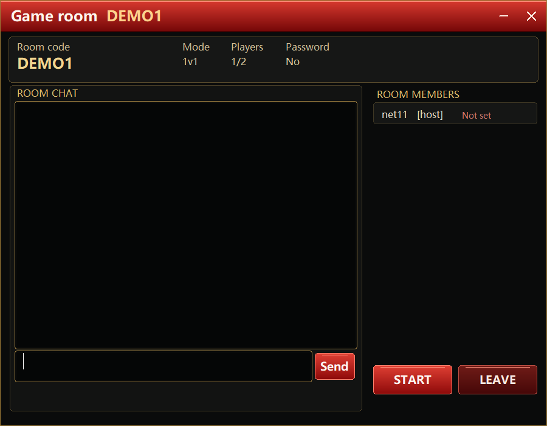

<p align="center">
  
</p>

# Net Goal 11

**LAN-play tunnel for FIFA 11**

- Repository: <https://github.com/loudiwang/net-goal-11>
- License: [GNU General Public License v3.0](LICENSE)

```bash
git clone https://github.com/loudiwang/net-goal-11.git
```

## Overview

Net Goal 11 is a LAN-play tunneling tool for **FIFA 11** (native C++, release 1.02).

FIFA 11 keeps its multiplayer mode inside the local network, so players in different cities
cannot see each other's rooms. Net Goal 11 injects a small x86 Hook into the game and relays
the game's UDP traffic straight to a public relay server, which forwards it to the other
players. Everyone ends up in the game's ordinary LAN mode, as if all the machines were
plugged into the same switch - no public IP, no router port forwarding and no virtual
network adapter driver.

## Features

- **FIFA 11 LAN play over the internet** - the game keeps using its standard LAN mode; the
  tunneling is completely transparent to it.
- **Direct Hook-to-relay path** - `game -> Hook -> public relay -> peers`, with no extra
  local IPC hop and no per-packet polling, which keeps latency low.
- **Virtual LAN spoofing** - the Hook fakes a `10.213.77.0/24` subnet, so the game still
  sees ordinary LAN broadcast and unicast traffic.
- **Room system** - room list and join-by-room-code, optional room passwords, and `1v1`
  `2v2` `3v3` `4v4` `5v5` modes.
- **Simple sign-in** - start the client, enter the relay IP, the UDP port, a nickname and
  the shared passphrase `goal11`, pick the game executable, then create or join a room.
- **Relay server for two platforms** - Linux (`epoll`, single static musl binary) and
  Windows (`select`, for local testing).
- **Live status** - up/down traffic counters and a run log in the main window.

## Screenshots

| Login window | Main window |
| --- | --- |
|  |  |

| New Room dialog | Game room |
| --- | --- |
|  |  |

- **Login window** - relay server IP, port (default `45888`), in-game nickname and the
  shared passphrase `goal11`.
- **Main window** - game/platform tree on the left, room list in the middle (room code,
  host, mode, players), nickname / game executable / Browse / Save settings / Launch game
  and the packet-log switch on the right, plus the run log and traffic counters.
- **New Room dialog** - room code, optional room password and the `1v1` `2v2` `3v3` `4v4`
  `5v5` mode selector; after creating the room you are taken into it and can share the room
  code with the other players.
- **Game room** - room summary (code, mode, players, password), the member list with the
  `Ready` / `Not set` game-path state, the room chat and the `START` / `LEAVE` buttons.

## Repository layout

```text
Net Goal 11/
  README.md              this file
  docs/images/           screenshots and artwork used by this README
  native/
    common/              protocol, version, game-name tables
    hook/                x86 Hook injected into the game (direct relay)
    client/              Win32 client, login window and room window
    server/              Linux / Windows UDP relay server
    build/               one-shot build with Zig
    tests/               manual / semi-automatic network and UI tests
```

## Quick start

```powershell
# 1. build (needs Zig 0.17+); output goes to native/dist/
powershell -ExecutionPolicy Bypass -File .\native\build\build_all.ps1

# 2. run the relay server locally for testing
.\native\dist\server-win-x64\"Net Goal 11.Server.exe" --port 45888
```

On a Linux VPS, unpack `Net Goal 11-server-linux-x64.zip` and run `sudo bash deploy-linux.sh`.
Remember to open the chosen **UDP port** (default `45888`) in the firewall and cloud security
group.

Then start `Net Goal 11.exe`, enter the relay IP, port `45888`, your nickname and the
passphrase `goal11`, pick your game executable, create or join a room and start the match.

## Compatibility

- client and Hook must be x86 - the FIFA 11 executable is 32-bit;
- build client, Hook and server from the same revision; older builds that predate the encrypted
  transport cannot connect to a current server;
- all client/Hook <-> server traffic (room browser, room chat, relayed game packets) is encrypted:
  an ephemeral X25519 key exchange combined with the server's long-term key establishes
  per-direction keys, and every datagram is sealed with XSalsa20-Poly1305 (NaCl secretbox) and a
  replay window;
- the server authenticates itself with a long-term key (created on first start in the server's
  working directory, `/var/lib/net-goal-11/server.key` under systemd) whose fingerprint is printed in the
  server log; clients pin that key on first use (trust on first use) and refuse to connect if it
  changes, which defeats an impostor relay except at the very first contact. Delete
  `%LOCALAPPDATA%\Net Goal 11\pinned_servers.txt` (or its matching line) to trust a reinstalled
  server again.

## Credits

- **[FIFAConnector](https://github.com/Pilo11/FIFAConnector)** by Nils B. - the FIFA 11
  LAN-play workflow of Net Goal 11 (room discovery and negotiation, and relaying the game's
  UDP traffic so remote players end up in the game's normal LAN mode) was designed with
  reference to this project. FIFAConnector is MIT licensed; its notice is reproduced in
  [`THIRD-PARTY-NOTICES.md`](THIRD-PARTY-NOTICES.md).

## License

This project is released under the
[GNU General Public License v3.0](LICENSE).

Copyright (C) 2026 Net Goal 11 Contributors

You may use, modify and redistribute this project freely; if you distribute a modified
version (including binaries only), it must also be licensed under the GPL-3.0 and you must
make the complete corresponding source code available to the recipients. There is no
warranty.
